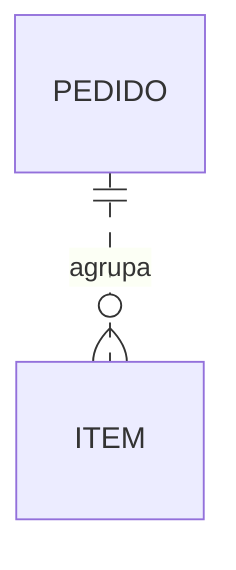

# Notação e renderização local

Referência de sintaxe: https://mermaid.js.org/syntax/entityRelationshipDiagram.html

## Mermaid ER



Neste exemplo ilustrativo, cada item está ligado a exatamente um pedido e um pedido pode ter zero ou muitos itens. Essa cardinalidade e a relação não identificadora são hipóteses do exemplo, não padrões a impor ao domínio.

- `||`: exatamente um; `o|` à direita / `|o` à esquerda: zero ou um.
- `o{` à direita / `}o` à esquerda: zero ou muitos; `|{` / `}|`: um ou muitos.
- `--`: relação identificadora; `..`: não identificadora. Isso não significa, respectivamente, certeza e hipótese. Não use tracejado para codificar status de validação no ER Mermaid.
- Chaves de atributos: `PK`, `FK`, `UK`; múltiplas chaves usam vírgula, por exemplo `PK, FK`. `NN` não é uma chave válida. Documente obrigatoriedade semanticamente; não invente marcadores.
- No conceitual, omita chaves físicas e atributos que não agreguem significado. Não force FK onde uma associação já comunica a relação.
- Cardinalidade ou identificação desconhecida não pode ser silenciosamente substituída para gerar ER. Mostre a associação em visão conceitual rotulada e mantenha a lacuna no texto. O fallback exporta `flowchart` quando os qualificadores de ER não estão completos; esse arquivo não é um ER Mermaid completo.

## Renderizador próprio, sem pacotes externos

`scripts/render_model.py` recebe JSON sem código e produz `.svg`, `.mmd` e `.scene.json`. No Windows, `--png` chama o script próprio `scripts/render_scene.ps1`, que desenha a mesma cena via System.Drawing. Não interpreta nem rasteriza Mermaid; SVG e PNG são saídas do mesmo modelo geométrico. Não há chamadas de rede.

```text
python scripts/render_model.py CAMINHO/modelo.json --output CAMINHO/diagrama --png
```

O prefixo de saída deve estar em uma pasta autorizada. Os arquivos existentes não são sobrescritos sem `--overwrite`. Use caminhos absolutos e mantenha entradas e saídas fora desta skill.

JSON mínimo: `title`, `subtitle`, `layer` (`conceitual`, `logico` ou `fisico`), `width`, `height`, `sources` (mapa de IDs para descrições), `nodes`, `edges` e `notes`. Uma nota não substitui evidência por item.

Cada nó tem `id` ASCII, `label`, `lines`, `status` (`decidido`, `proposto`, `hipótese` ou `pendente`), `sources`, `x`, `y`, `w`, `h`. Coordenadas são decisões de apresentação, não de domínio.

Cada aresta tem `id`, `from`, `to`, `label`, `status`, `sources`, `target_per_source`, `source_per_target`, `identifying` (`true`, `false` ou `null`), `points` (lista de pares x/y) e `label_at` (x/y). Cardinalidades aceitas: `1`, `0..1`, `0..N`, `1..N`, `?`. Para uma aresta A→B, `target_per_source` significa quantos B podem corresponder a um A; a inversa fica em `source_per_target`. A direção organiza a leitura, não implica fluxo, causalidade ou cascata.

O script verifica IDs, referências de fonte, endpoints, cardinalidades, sobreposição de caixas e limites geométricos; não valida a verdade das regras nem impede todo cruzamento de linhas. O layout é explícito, não automático. Texto excessivo pode exigir redistribuir caixas ou dividir em visões. Inspeção visual continua obrigatória.

O fallback desenha relações com traço neutro e status textual explícito, sem alegar a semântica identificadora das linhas Mermaid. Cardinalidades `?` são lacunas, nunca evidência de ausência de relação. Declare no documento as associações propostas e os qualificadores não resolvidos.

Se a sandbox bloquear a execução do script PNG, os arquivos SVG e Mermaid já gerados continuam disponíveis. Use somente o mecanismo de aprovação do executor para tentar a mesma renderização autorizada; não altere políticas de execução nem contorne o bloqueio. Sem autorização ou capacidade de inspeção, relate a limitação e não declare a imagem conferida.

Verificação dos guardrails do renderizador: `python scripts/test_render_model.py`. Esses testes não substituem validação semântica do modelo nem inspeção visual.

## Campos editáveis no modelo lógico

Um nó pode declarar `canonical_name` (singular snake_case) para que o ER Mermaid utilize o nome canônico em vez do alias geométrico `id`. A lista opcional `attributes` preserva campos na exportação ER: `name`, `type` semântico, `keys` (`PK`, `FK`, `UK`), `status`, `sources` e `comment`; `references` pode documentar o destino lógico. Não usar `NN` como chave. A obrigatoriedade e os conflitos ficam no dicionário. O renderer valida nomes, chaves e fontes dos atributos, não tipos físicos do motor nem integridade em banco.

As `lines` são a apresentação resumida no PNG/SVG; conferir sua correspondência com `attributes` e o dicionário. Campos derivados não devem ser inseridos em `attributes` como colunas: a convenção herdada prevê views na futura materialização.
